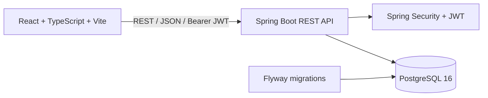

<div align="center">

# NEXODESK

### Intelligent IT Service Management Platform

Una plataforma Full Stack para gestionar solicitudes de soporte técnico con autenticación JWT, control de acceso por roles y seguimiento de tickets.

[](https://www.oracle.com/java/)
[](https://spring.io/projects/spring-boot)
[](https://react.dev/)
[](https://www.typescriptlang.org/)
[](https://www.postgresql.org/)
[](#licencia)

</div>

## Tabla de contenidos

- [Descripción](#descripción)
- [Estado actual](#estado-actual)
- [Características implementadas](#características-implementadas)
- [Stack tecnológico](#stack-tecnológico)
- [Arquitectura](#arquitectura)
- [Estructura](#estructura)
- [Requisitos](#requisitos)
- [Instalación y ejecución](#instalación-y-ejecución)
- [API](#api)
- [Roles y permisos](#roles-y-permisos)
- [Pruebas](#pruebas)
- [Capturas](#capturas)
- [Roadmap](#roadmap)
- [Autor](#autor)

## Descripción

NEXODESK es un proyecto de portafolio orientado a la gestión de servicios de TI (ITSM). El sistema conecta una API REST construida con Spring Boot y una interfaz SaaS construida con React para registrar, priorizar, asignar y dar seguimiento a tickets de soporte.

El proyecto está diseñado para ejecutarse localmente en Windows 11 sin Docker obligatorio. Las credenciales y secretos se proporcionan mediante variables de entorno y no forman parte del repositorio.

## Estado actual

### Implementado

- Registro de empleados e inicio de sesión.
- Contraseñas con BCrypt.
- Autenticación stateless mediante JWT.
- Roles `ADMIN`, `TECHNICIAN` y `EMPLOYEE`.
- Creación, consulta y listado de tickets.
- Actualización de tickets y estados.
- Prioridades `LOW`, `MEDIUM`, `HIGH` y `CRITICAL`.
- Asignación de técnicos.
- Comentarios e historial de cambios.
- Validación de solicitudes y manejo global de errores.
- Migración Flyway inicial para usuarios y tickets.
- Documentación OpenAPI/Swagger.
- Frontend React responsive con tema claro/oscuro.
- Dashboard conectado a la API.

### Alcance actual

La página frontend de usuarios y técnicos está preparada como vista informativa, pero no muestra datos simulados porque la API actual todavía no expone endpoints de administración de usuarios.

Este repositorio no representa un despliegue en producción. Es un proyecto de portafolio en desarrollo.

## Stack tecnológico

### Frontend

- React 19
- TypeScript 5.9
- Vite
- Tailwind CSS
- React Router
- Axios
- Lucide React

### Backend

- Java 21
- Spring Boot 3.5
- Spring Web
- Spring Security
- Spring Data JPA / Hibernate
- JWT con JJWT
- Bean Validation
- Maven
- Swagger / OpenAPI
- JUnit 5 y Mockito

### Datos

- PostgreSQL 16
- Flyway
- Migraciones SQL versionadas

## Arquitectura



El backend separa controladores, servicios, repositorios, entidades, DTOs, seguridad y manejo de excepciones. El frontend separa páginas, componentes, contexto de autenticación, servicios HTTP y tipos.

## Estructura

```text
NEXODESK/
├── backend/
│   ├── pom.xml
│   └── src/
│       ├── main/java/com/nexodesk/
│       │   ├── auth/
│       │   ├── common/
│       │   ├── config/
│       │   ├── ticket/
│       │   └── user/
│       ├── main/resources/
│       │   ├── application.yml
│       │   └── db/migration/
│       └── test/
├── frontend/
│   ├── package.json
│   └── src/
│       ├── components/
│       ├── context/
│       ├── pages/
│       ├── api.ts
│       └── types.ts
├── docs/
│   ├── ARCHITECTURE.md
│   ├── ERD.md
│   ├── ROLES.md
│   └── TICKETS.md
├── .gitignore
└── README.md
```

## Requisitos

- Windows 11, macOS o Linux.
- JDK 21.
- Maven 3.9.x.
- Node.js 20+ y npm.
- PostgreSQL 16.

Docker es opcional; no es necesario para ejecutar el proyecto localmente.

## Instalación y ejecución

### 1. Clonar el repositorio

```powershell
git clone https://github.com/DavidSaavedraDev/-Nexodesk.git
cd -Nexodesk
```

### 2. Preparar PostgreSQL

Crear la base de datos y el usuario con permisos sobre el esquema `public`:

```sql
CREATE USER nexodesk_user WITH PASSWORD 'local_password';
CREATE DATABASE nexodesk OWNER nexodesk_user;
```

No uses esta contraseña en el repositorio. Si los objetos ya existen, no los recrees.

### 3. Configurar el backend

En PowerShell, define las variables únicamente para la sesión local:

```powershell
$env:DB_HOST="localhost"
$env:DB_PORT="5432"
$env:DB_NAME="nexodesk"
$env:DB_USERNAME="nexodesk_user"
$env:DB_PASSWORD="your_local_database_password"
$env:JWT_SECRET="a-local-secret-with-at-least-32-characters"
$env:JWT_EXPIRATION_MINUTES="60"
```

Desde `backend/`:

```powershell
mvn clean verify
mvn spring-boot:run
```

Flyway aplica automáticamente las migraciones al iniciar Spring Boot.

### 4. Configurar el frontend

Desde `frontend/`:

```powershell
npm install
Copy-Item .env.example .env
npm run dev
```

El archivo `.env.example` contiene únicamente:

```text
VITE_API_URL=http://localhost:8080/api
```

El frontend estará disponible en `http://localhost:5173`.

### 5. Build de producción local

```powershell
cd frontend
npm run build
npm run preview
```

## API

Base URL local: `http://localhost:8080/api`

| Método | Endpoint | Acceso |
|---|---|---|
| `GET` | `/health` | Público |
| `POST` | `/auth/register` | Público; crea empleados |
| `POST` | `/auth/login` | Público |
| `POST` | `/tickets` | Usuario autenticado |
| `GET` | `/tickets` | Usuario autenticado |
| `GET` | `/tickets/{id}` | Solicitante, técnico con acceso o admin |
| `PUT` | `/tickets/{id}` | Según rol y ownership |
| `POST` | `/tickets/{id}/assign` | Admin o técnico |
| `POST` | `/tickets/{id}/comments` | Usuario con acceso |
| `GET` | `/tickets/{id}/comments` | Usuario con acceso |
| `GET` | `/tickets/{id}/history` | Usuario con permisos de gestión |

Swagger UI:

```text
http://localhost:8080/swagger-ui/index.html
```

OpenAPI JSON:

```text
http://localhost:8080/v3/api-docs
```

La API usa `Authorization: Bearer <JWT>` para endpoints protegidos.

## Roles y permisos

| Rol | Capacidades actuales |
|---|---|
| `ADMIN` | Consulta y gestión global de tickets; asignación; acceso administrativo de tickets |
| `TECHNICIAN` | Consulta de tickets, gestión de tickets asignados o disponibles según reglas del servicio, asignación y comentarios |
| `EMPLOYEE` | Registro, creación de tickets, consulta de sus tickets, actualización mientras no estén cerrados y comentarios |

La autorización se valida en el backend. Las rutas protegidas del frontend solo son una capa de experiencia de usuario.

## Pruebas

Backend:

```powershell
cd backend
mvn clean verify
```

Frontend:

```powershell
cd frontend
npm run build
```

Las pruebas unitarias actuales cubren generación JWT, BCrypt y reglas de acceso de tickets. Las pruebas contra PostgreSQL y las pruebas end-to-end del frontend quedan como trabajo futuro.

## Capturas

> Espacio reservado para capturas reales del producto. No se incluyen imágenes simuladas.

| Vista | Captura |
|---|---|
| Login | `screenshots/login.png` |
| Dashboard | `screenshots/dashboard.png` |
| Tickets | `screenshots/tickets.png` |
| Detalle de ticket | `screenshots/ticket-detail.png` |

## Roadmap

- [x] Estructura inicial y documentación técnica.
- [x] API Spring Boot con PostgreSQL y Flyway.
- [x] Autenticación JWT y roles base.
- [x] Gestión inicial de tickets.
- [x] Frontend React conectado a la API.
- [x] Tema claro/oscuro y layout responsive.
- [ ] Endpoints completos de administración de usuarios.
- [ ] Inventario tecnológico.
- [ ] Base de conocimientos.
- [ ] Dashboard avanzado y reportes exportables.
- [ ] Auditoría general de operaciones.
- [ ] Pruebas de integración y end-to-end.
- [ ] Preparación de despliegue.

## Autor

Desarrollado por [David Saavedra](https://github.com/DavidSaavedraDev).

Este proyecto forma parte de mi portafolio de desarrollo Full Stack.

## Licencia

Proyecto de portafolio en desarrollo. No se ha definido todavía una licencia de distribución.
