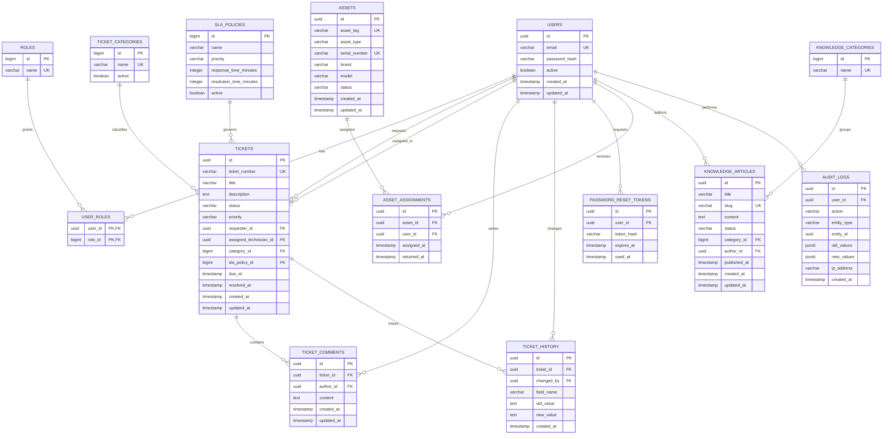

# Modelo entidad-relación inicial

El siguiente modelo representa la base funcional inicial de NEXODESK. Los nombres de estados y tipos se implementarán como enums controlados por el backend.

## Índices iniciales

- `users.email`
- `tickets.ticket_number`
- `tickets.status`
- `tickets.priority`
- `tickets.created_at`
- `tickets.assigned_technician_id`
- `ticket_comments.ticket_id`
- `ticket_history.ticket_id`
- `assets.serial_number`
- `knowledge_articles.slug`
- `audit_logs.user_id`
- `audit_logs.created_at`

Todas las tablas y relaciones se crearán mediante migraciones Flyway. El diseño podrá evolucionar durante la implementación, pero los cambios deberán quedar versionados y revisados.
